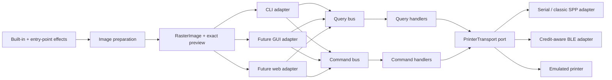

# Driver architecture

The Python implementation uses CQRS to keep presentation code, printer use
cases, and transport details independent. A CLI, desktop GUI, or web service
constructs the same application object and sends typed messages through its
command and query buses.

## Layers

- `domain.py` contains immutable printer status, device information, raster
  data, and domain errors. It has no operating-system dependencies.
- `messages.py` contains immutable commands, queries, and results.
- `application.py` owns dispatch and use-case sequencing. It depends only on
  the transport port and protocol/domain modules.
- `ports.py` defines the byte-transport contract used by handlers.
- `protocol.py` encodes and decodes verified wire values without performing
  I/O.
- `preprocessing.py` normalizes Pillow images, applies ordered registered
  effects, performs deterministic dithering, and returns both the domain raster
  and its exact preview. Installed packages can contribute effects through the
  `tronic_printer.image_effects` entry-point group.
- `infrastructure/serial.py` implements classic RFCOMM/SPP through a Windows or
  Linux serial device. Writes follow the official app's 16,384-byte limit.
- `infrastructure/ble.py` provides passive discovery, metadata-only GATT
  enumeration, and a synchronous CQRS adapter backed by an asyncio event-loop
  thread. It implements the verified FF01/FF02/FF03 response, write, credit,
  and packet-size behavior.
- `testing.py` provides scripted and stateful in-memory transports.
- `cli.py` is a thin presentation adapter. It owns consent flags but no printer
  protocol logic. Its preview and image-printing commands use the same
  preparation API available to GUI and web callers.

## Safety boundaries

Queries and commands are distinct types, but some queries still transmit bytes
to physical hardware. Consequently the CLI and HIL rig require `--live` for
all connections. Operations that activate the head or move paper additionally
require `--allow-printing`.

The application handler also queries status immediately before printing and
refuses the job when the cover is open, paper is absent, or either known
overheat bit is set. Raster frames wider than the verified 384-dot head are
rejected before transport access.
